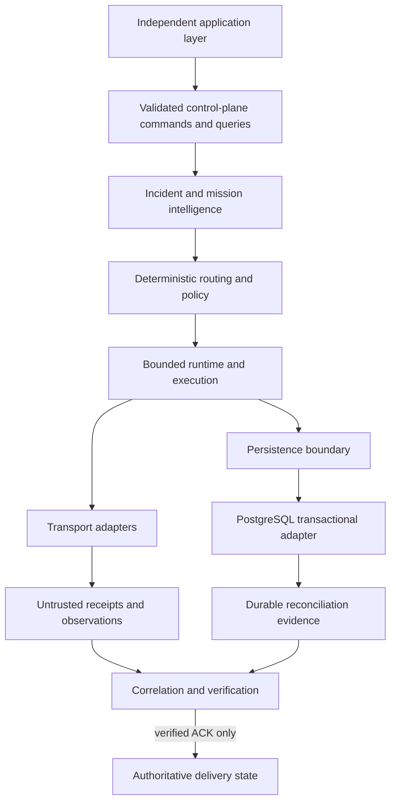

# Autonomous Resilient Communication Intelligence

ARCI is a deterministic communication-orchestration core for disasters, outages, weak networks, and rapidly changing connectivity. It observes operational state, selects a policy-compliant route, executes through bounded adapters, verifies acknowledgement evidence, and replans when delivery is not established.

The repository originated as **StarryLink Next**. Its central design rule remains simple: execution, provider acceptance, database persistence, and operator authorization are evidence—not proof of delivery. Only the verification boundary may establish delivery.

## Why ARCI Exists

Emergency communication systems must continue making safe, explainable decisions when networks degrade and external services return incomplete or contradictory evidence. ARCI separates deterministic authority from probabilistic interpretation and infrastructure observations, making failure and uncertainty explicit rather than turning them into optimistic success.

## Core Capabilities

- Deterministic routing, policy enforcement, execution, verification, and bounded adaptation.
- Structured mission and incident interpretation with a constrained LLM boundary and deterministic fallback.
- Operator commands, review workflows, replayable projections, and a tested dashboard client boundary.
- Durable local outbox and evidence repositories with bounded reads and schema validation.
- Authenticated loopback provider and controlled local transport simulations.
- Production-security contracts for secret custody, service identity, audit integrity, admission control, configuration, and administration.
- A real, disposable PostgreSQL 18.4 transactional adapter with serializable CAS, idempotency, ambiguous-commit handling, durable reconciliation, restart testing, and least-privilege roles.

Implemented capabilities are exercised locally and in simulation. The static competition frontend can be hosted for judging, but ARCI has no operational backend deployment, live carrier integration, real satellite or LoRa field validation, public control-plane ingress, production credentials, or compliance certification.

## Presidential Competition Hardening V1

The competition surface extends the existing cinematic without replacing its visual source of truth or scroll timeline. After the opening, it exposes an evidence-linked pipeline from public context through the disaster digital twin, hard constraints, adaptive scoring, simulated execution, ACK verification, re-planning, metrics, and audit records.

- `LIVE`, `REPLAY`, and `SIMULATION` are distinct. LIVE currently fetches only the verified MOI village population publication; it fails closed to fixed replay records if the response is unavailable, invalid, inconsistent, or stale. CWA and TDX remain credential-blocked.
- MOI, NCC, and MOA records are public structural context. Incident rainfall, outages, route state, message outcomes, and all communication links are explicitly simulated.
- The deterministic engine uses ten inspectable weights and hard-rejects infeasible candidates before ranking. No LLM owns routing or delivery authority.
- Three fixed scenarios cover primary outage, simultaneous rural demands with store-and-forward, and a secondary selected-link failure followed by re-planning.
- `npm run presidential:benchmark` executes 100 evaluations. Outcome metrics are simulated; wall-clock decision latency is measured on the executing device.

See [Presidential architecture](docs/presidential-architecture.md), [decision engine](docs/decision-engine.md), [data sources](docs/data-sources.md), [benchmark](docs/benchmark.md), [data governance](docs/data-governance.md), and [competition demo](docs/competition-demo.md).

## Architecture



The deterministic runtime owns route selection, hard constraints, execution bounds, ACK verification, adaptation, and terminal state. Language models, transports, providers, infrastructure health, PostgreSQL rows, reconciliation, and administrators are non-authoritative. See [Architecture](docs/architecture.md) for the complete model.

## Resilience Model

ARCI uses an observe–understand–plan–act–verify–adapt loop. Every significant route change must follow from observed state and policy evaluation. Failed or uncertain persistence is represented explicitly:

```text
COMMITTED
NOT_COMMITTED
UNKNOWN_REQUIRES_RECONCILIATION
```

For PostgreSQL, errors after `COMMIT` dispatch are conservative: an outcome that cannot be proven is reconciled by immutable transaction, operation, idempotency, owner, request fingerprint, adapter generation, and logical-sequence evidence. A database commit never establishes message delivery.

## Repository Structure

```text
src/
├── domain/          identifiers and core domain values
├── policy/          deterministic hard constraints
├── routing/         discovery, scoring, and route decisions
├── runtime/         bounded orchestration and state transitions
├── verification/    sole delivery-authority boundary
├── intelligence/    structured interpretation and explanation
├── control-plane/   validated commands, queries, and projections
├── dashboard/       application-facing dashboard adapter and UI
├── integration/     transport contracts, correlation, outbox, evidence
├── provider/        authenticated provider sandbox boundary
├── foundations/     audit, identity, admission, configuration, transactions
├── infrastructure/  adapter contracts and PostgreSQL implementation
├── presidential/    competition data, digital twin, deterministic engine, benchmark, and UI
├── simulation/      deterministic scenario fixtures
└── cli/             reproducible scenario and audit entry points
tests/               unit, architecture, security, scenario, and acceptance tests
docs/                architecture, phase evidence, status, and integration guidance
```

## Quick Start

Requirements: Node.js 20 or newer and npm. The PostgreSQL acceptance suite uses repository-scoped `embedded-postgres`; it creates a random loopback-only cluster under ignored `/.arci-postgres/` and generates per-run credentials in memory.

```bash
npm ci
npm run scenario -- compare
npm run presidential:benchmark
npm run runtime -- determinism
npm test
```

Run the dashboard locally with `npm run dashboard`. It is a tested project surface, not evidence of a deployed service.

## Production Deployment

The existing Vercel project deploys only the static Vite web layer (`vercel.json`: `npm ci` → `npm run build` → `dist/dashboard`). From an authenticated checkout already linked through `.vercel/project.json`:

```bash
npx vercel deploy --prod
```

Do not create a second Vercel project. The deterministic replay and simulation paths need no environment variables. CWA and TDX credentials are intentionally not used by the browser build; a future credentialed adapter must run behind a server-side boundary. The PostgreSQL, provider sandbox, control plane, and other stateful repository components are not deployed to Vercel.

## Configuration

The default repository workflows and deterministic competition demo need no secrets. Local `.env` files are ignored, and no production connection string is required or supported by the Phase 4H acceptance harness. Infrastructure contracts accept closed, typed configuration; the PostgreSQL adapter is restricted to `CONTRACT_ONLY` activation. `.env.example` lists optional server-side CWA and TDX variable names only; browser code does not read or expose them.

Do not commit credentials, connection strings, tokens, private keys, local database clusters, logs, coverage, or build output. A future host application must inject secret references through its own server-side boundary and keep raw credentials outside client-visible state and durable evidence.

## Running Tests

Core engineering gates:

```bash
npm run lint
npm run typecheck
npm test
npm run build
npm audit --audit-level=low
```

Focused PostgreSQL and determinism gates:

```bash
npm run postgres:acceptance
npm run postgres:acceptance:repeat
npm run provider-sandbox:scenarios -- determinism
npm run production-foundations:scenarios -- determinism
npm run staging-infrastructure:scenarios -- determinism
npm run audit:verify -- self-test
```

`npm run postgres:acceptance` runs the disposable server, migration, privilege, transaction, reconciliation, restart, concurrency, error-safety, and authority-separation checks. The complete suite uses at most 50% of Vitest workers to prevent unrelated real-server scenario tests from manufacturing wall-clock timeout failures.

## Security and Reliability

The repository applies exact boundary projection, schema validation, bounded canonicalization and file reads, parameterized SQL, checksummed forward migrations, least-privilege local database roles, credential-safe error normalization, owned pool cleanup, explicit reconciliation, idempotency fences, and architecture tests that preserve verification authority.

Security claims are limited to reproducible repository evidence. See [Security policy](SECURITY.md), [Production security foundations](docs/production-security-foundations.md), [Staging infrastructure threat model](docs/staging-infrastructure-architecture.md), and [PostgreSQL adapter acceptance](docs/postgresql-adapter-acceptance.md).

## Current Project Status

Phase 4H implements the first real disposable infrastructure adapter—PostgreSQL transactional persistence—and is closed as a locally reproducible, non-security-certified engineering checkpoint. All locally executable engineering gates passed. Codex Security Deep Scan did not execute because the current host lacks its required managed read-only filesystem permission profile, so no Deep Scan verdict or canonical artifacts exist. Phase 4H must not be described as security-ready, security-certified, Deep-Scan-passed, or production-ready.

See [Project status](docs/PROJECT-STATUS.md) for the current functional and external-security verification state.

## Known Limitations

- PostgreSQL evidence is local disposable acceptance, not managed production validation.
- Backup/restore, replication, failover, TLS/mTLS, workload identity, credential rotation, capacity, and long-duration load are not yet proven.
- Transport and provider integrations are loopback or simulated; there is no live telecom, satellite, LoRa, drone, or public network integration.
- Official population, base-station-count, and crop records provide structural context only; they do not prove incident exposure, live coverage, crop loss, or field outcomes.
- The Vite/Vercel competition surface is a static client. LIVE mode is limited to a public MOI request and cannot securely hold CWA/TDX credentials; those adapters require a future server-side boundary.
- The language-model boundary is constrained and optional; deterministic policy remains authoritative.
- The opening and competition lab are a polished demonstration surface, not a field-deployed emergency operations product.
- No external deployment, users, partnerships, certifications, or field trials are claimed.

## Application Layer Strategy

ARCI Core should remain domain-agnostic. Future applications—such as Agricultural Resilience Command, disaster response, medical response, or field-responder tools—should live in separate products and integrate through versioned commands, queries, projections, events, and transport ports. They may map domain language onto ARCI concepts but must not bypass policy, verification, reconciliation, or authority boundaries.

See [Application integration](docs/APPLICATION-INTEGRATION.md) for the supported separation and versioning expectations.

## Documentation

- [Architecture](docs/architecture.md) — authoritative system boundaries, flows, security model, and test strategy.
- [Application integration](docs/APPLICATION-INTEGRATION.md) — how independent domain applications connect without coupling the core.
- [Project status](docs/PROJECT-STATUS.md) — sealed baseline, Phase 4H verification state, and next action.
- [PostgreSQL adapter acceptance](docs/postgresql-adapter-acceptance.md) — Phase 4H implementation and limitations.
- [Scenarios](docs/scenarios.md) — deterministic scenario coverage.
- [StarryRuntime](docs/starry-runtime.md) — orchestration lifecycle and recovery.
- [Communication intelligence](docs/communication-intelligence.md) — semantic and LLM boundaries.
- [Real-world integration architecture](docs/real-world-integration-architecture.md) — provider-neutral adapter contracts.
- [Controlled local transport](docs/controlled-local-transport.md) — durable evidence and ACK ingestion.
- [Authenticated provider sandbox](docs/authenticated-provider-sandbox.md) — authentication, authorization, replay, and restart.

This repository does not currently contain an authorized software license; no license grant is implied.
