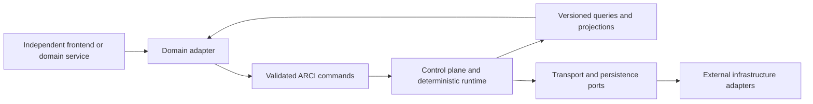

# Application Integration Boundary

ARCI Core is a reusable, domain-agnostic communication-orchestration engine. A domain product should depend on its validated public boundaries rather than adding agricultural, medical, disaster-response, or field-workflow logic to the core.

## Boundary

The current application-facing boundary is represented by validated control-plane commands and queries in `src/control-plane/`, the dashboard port in `src/dashboard/adapter.ts`, structured projections in `src/control-plane/projections.ts`, and provider-neutral transport contracts in `src/integration/contracts.ts`.

An application may name or group ARCI concepts differently, but should map them onto actual core concepts such as mission, incident, message/request, route, transport, priority, attempt, receipt, acknowledgement evidence, review, and runtime state. Persistence entities and infrastructure evidence are not application delivery state.

## Domain Adapter Responsibilities

A domain adapter should:

- validate application input before producing an ARCI command;
- translate domain priorities and resources into existing typed mission and policy inputs;
- retain ARCI correlation, idempotency, generation, and evidence identities;
- expose only allowlisted query projections to the frontend;
- render uncertainty, degraded state, review requirements, and verified delivery accurately;
- keep secrets and provider SDK objects on the server side;
- treat all external callbacks and receipts as untrusted until the existing correlation and verification path accepts them.

It must not create direct setters for delivery, inject database rows as runtime outcomes, reinterpret provider acceptance as acknowledgement, or bypass operator/policy controls.

## API and Event Contracts

Today the boundary is an in-process TypeScript API. A separate service may host it behind HTTP, RPC, SSE, or another transport, but that host must preserve the schemas and semantics in `src/control-plane/api.ts`, `src/control-plane/schemas.ts`, `src/control-plane/model.ts`, and `src/integration/schemas.ts`.

Commands are requests to act and require stable command, mission, and correlation identities. Queries return deterministic read models. Runtime and integration events are evidence used to derive projections; they are not an invitation for a frontend to mutate core state. Only the verification engine may establish delivery after correlated acknowledgement evidence.

## Shared Types and Versioning

An external application should consume a deliberately exported contract package or generated schema artifact rather than importing internal implementation files by path. That package does not yet exist; creating it belongs to a later bounded integration phase.

When introduced, contracts should follow these rules:

- additive optional fields may be introduced within a compatible version;
- required fields, enum removals, authority semantics, or identity rules require an explicit contract version change;
- unknown inputs continue to fail closed at trust boundaries;
- event consumers must tolerate additive event metadata but never infer delivery from unknown event types;
- application and core releases are versioned independently.

## Frontend Independence

Agricultural Resilience Command, disaster-response consoles, medical-response tools, and field-responder interfaces are possible extension products, not implemented capabilities. Each should be created in a separate repository or separately versioned application workspace. Their visual systems, user roles, workflows, offline caches, and domain data belong outside ARCI Core.

ARCI should change only when a generally reusable communication contract or verified core capability is required. Domain-specific labels, crop models, patient records, maps, forms, and presentation logic should remain in the application layer.

## Security Expectations

The hosting application is responsible for authentication, authorization, rate limiting, transport security, deployment identity, secret injection, privacy controls, and safe public ingress. Those responsibilities do not transfer delivery authority away from ARCI's verification engine. A production host must also provide independently validated storage, backup/recovery, monitoring, and operational controls beyond the disposable Phase 4H PostgreSQL harness.
