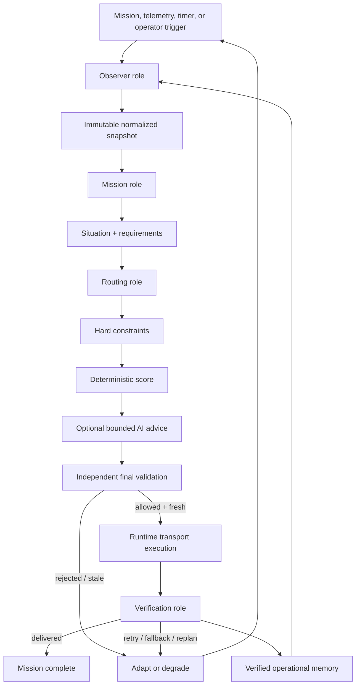
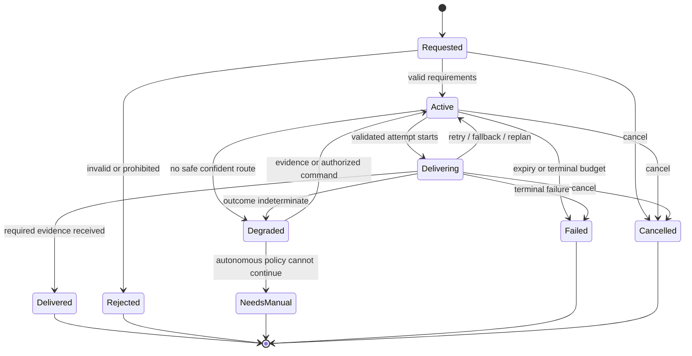

# Starry Intelligence Agent System

Status: Phase 0 behavioral specification

Audience: domain, runtime, simulation, UI, and test implementers

## 1. What “agent” means here

Starry Intelligence is one bounded autonomous runtime with four logical roles:

- **Observer** turns noisy, partial telemetry into a normalized view of reality.
- **Mission** converts an explicit user need into versioned communication requirements.
- **Routing** enumerates feasible routes, applies policy, scores choices, and proposes a plan.
- **Verification** decides whether execution evidence proves delivery and what should happen next.

These roles are ordinary TypeScript modules with typed inputs and outputs. They do not maintain separate personalities, chat with each other, vote, or delegate through natural language. `StarryRuntime` controls ordering, time, cancellation, state, and side effects. This preserves inspectability and avoids performative multi-agent complexity.

The optional AI provider is not a fifth autonomous actor. It is a fallible advisory dependency called at narrow points and constrained by schemas, candidate allowlists, timeouts, and policy validation.

Together, the roles implement the canonical product loop: **Observe → Understand → Plan → Act → Verify → Adapt**. `StarryRuntime` owns every transition around that loop.

## 2. Control model



Only the runtime executor crosses the external-action boundary. Observer, Mission, Routing, Verification, scorers, policy modules, and AI providers return data; none can call a transport directly.

## 3. Shared input contract

Each decision cycle reads one `DecisionContext` containing:

- `runId`, `missionId`, `missionGeneration`, `cycleId`, and mode;
- immutable environment, device, mission, graph, and operational-memory snapshots;
- their versions, timestamps, provenance, freshness, and quality;
- policy and scoring profile versions;
- remaining mission time, attempts, energy/cost allowance, and rate budget;
- previous validated decision and current route, if any;
- the cancellation signal and cycle deadline.

No role reads mutable global UI state. A role cannot silently fetch a newer snapshot midway through calculation. If new evidence arrives, the runtime changes the state version and starts or schedules a new cycle.

## 4. Observer role

### 4.1 Responsibilities

Observer consumes channel samples, link probes, relay/node announcements, device telemetry, scenario inputs, and previous verified outcomes. It:

- schema-validates and bounds every value;
- normalizes units and channel naming;
- attaches source, observed time, received time, sequence, and trust quality;
- rejects impossible values and detects replay/out-of-order samples;
- calculates freshness and missing-data flags;
- merges samples using a deterministic precedence/window policy;
- derives bounded trends such as degrading, stable, recovering, or unknown;
- builds a versioned network graph;
- emits material-change and degradation reason codes.

It does not choose a route or infer a mission. “Cellular packet loss crossed the configured degradation threshold” is an observation. “Use LoRa” is not.

### 4.2 Material change and anti-flapping

A new sample increments the raw telemetry sequence, but only a material change increments the decision state version. Materiality is configured per signal using thresholds, time windows, and freshness.

Baseline behavior:

- hard unavailable, invalid topology, battery floor crossing, mission escalation, or active-route failure is immediately material;
- noisy signal and latency changes require a sustained window or meaningful delta;
- recovery requires a separate recovery threshold and duration (hysteresis);
- stale data decays toward `unknown`, never toward “healthy”;
- source conflicts lower evidence quality and can trigger degraded state.

### 4.3 Output

Observer produces a normalized snapshot and facts such as:

```text
CELLULAR_PACKET_LOSS_HIGH
CELLULAR_SIGNAL_CRITICAL
WIFI_UNAVAILABLE
LORA_RELAY_RECENTLY_OBSERVED
BATTERY_RESERVE_REACHED
TELEMETRY_STALE
```

Facts carry numeric evidence and source references but no display prose. The decision-summary renderer later maps them to concise, localizable text.

## 5. Mission role

### 5.1 Responsibilities

Mission converts a mission request into normalized requirements:

- category: medical emergency, distress, safety status, coordination, or general;
- urgency and expiry;
- minimum delivery reliability and verification strength;
- maximum tolerable latency;
- energy and monetary-cost tolerance;
- payload size, compression allowance, and delivery semantics;
- privacy class, relay restrictions, destination, and deduplication identity.

Explicit structured user choices such as “Medical” take precedence over inference. The runtime does not force a field user to understand 5G, LoRa, satellite, relays, compression, or retries.

### 5.2 Deterministic defaults and optional classification

Every supported mission category has deterministic, versioned requirement defaults. Optional AI classification is used only when an allowed free-text request is ambiguous. The provider receives minimized/redacted input and returns a strict category plus bounded attributes and uncertainty.

The Mission role rejects or falls back when the response is malformed, out of bounds, contradictory, too slow, or below its confidence threshold. It never lets user content or provider output modify policy. Free text is data, not a command to the runtime.

### 5.3 Mission requirement precedence

Highest to lowest authority:

1. hard safety/privacy policy;
2. authorized emergency or operator command;
3. explicit structured user intent;
4. deterministic category defaults;
5. bounded AI classification advice;
6. conservative fallback defaults.

Conflicts are traceable by reason code. A lower-precedence source cannot silently weaken a higher-precedence requirement.

## 6. Routing role

### 6.1 Responsibilities

Routing receives a fixed situation and returns a proposal, never an action. It:

1. enumerates graph paths supported by current device and relay capabilities;
2. generates legal transmission variants such as compression, store-and-forward, or authorized redundancy;
3. removes hard-policy violations;
4. estimates delivery, latency, energy, monetary cost, congestion, and relay risk;
5. applies missing/stale-evidence penalties;
6. scores remaining candidates using the mission profile;
7. optionally requests bounded advice over the existing candidate IDs;
8. applies deterministic tie-breaking and fallback ordering;
9. computes confidence separately from delivery probability;
10. emits a complete proposed decision for independent validation.

### 6.2 Candidate generation

Candidate enumeration is bounded by maximum hops, route count, graph age, supported interfaces, and cycle deadline. It avoids loops and repeated nodes. A route references the exact graph version from which it was derived.

Hybrid routes are ordinary multi-hop candidates. “Drone relay” or “satellite” is not automatically good or bad; availability, policy, mission requirements, device energy, latency, cost, memory, and verification support determine feasibility.

### 6.3 Constraints before scores

Hard constraints are predicates. If any hard predicate denies a candidate, no score, AI recommendation, or manual preference can restore it. Examples include prohibited privacy path, unsupported interface, expired mission, stale/absent route, exhausted attempts, energy-reserve protection, or emergency stop.

Soft constraints remain candidates with explicit penalties, such as high monetary cost, low historical sample count, congestion, or a route that is usable but near its latency tolerance.

### 6.4 Scoring

The initial scoring model is deterministic:

```text
utility =
  reliabilityWeight * expectedDelivery
  + latencyWeight    * deadlineFit
  + energyWeight     * energyFit
  + costWeight       * costFit
  + trustWeight      * relayTrust
  + historyWeight    * verifiedHistory
  - uncertaintyPenalty
  - congestionPenalty
  - switchPenalty
```

All components are normalized to a documented bounded range. Weights come from the versioned mission/scoring profile. They do not come from provider prose.

The switch penalty plus a configurable minimum-improvement margin prevents route flapping. It is ignored if the active route is unavailable, violates policy, cannot meet the mission deadline/reliability requirement, or has just failed verification.

Tie-breaking is stable: higher hard requirement satisfaction, higher expected delivery, lower mission deadline risk, then stable route ID. The trace records the tie-break rule.

### 6.5 Optional AI advice

AI advice may return:

- an ordering of known, already-allowed candidate IDs;
- bounded score adjustments or preference labels from an allowlist;
- uncertainty and short fact references;
- no tool call, route definition, retry policy, or executable parameter.

Provider influence has a configured cap. A large deterministic difference cannot be overturned by provider preference. The Routing role ignores extra candidate IDs, invalid numbers, unknown facts, and unstructured content. Failure uses the deterministic order with no loss of control capability.

### 6.6 Independent validation

The routing proposal is not executable until a validator outside Routing confirms membership, hard policy, state freshness, mission generation, policy/scoring versions, budgets, adapter capability, and any provider influence. Validation generates a short-lived execution capability. A stale proposal is replanned, not patched in place.

## 7. Verification role

### 7.1 Responsibilities

Verification consumes the validated plan, attempt record, transport receipt, end-to-end ACK/evidence, deadline, and mission verification policy. It:

- correlates evidence to mission, generation, attempt, payload digest, and deduplication identity;
- validates source/authenticity when the transport supports it;
- distinguishes accepted-for-send from delivered;
- rejects stale, duplicate, malformed, mismatched, or forged evidence;
- measures attempt and end-to-end latency;
- classifies the outcome and recommends no action, retry, fallback, full replan, degraded/manual escalation, or terminal failure;
- emits the only events allowed to update success/failure memory.

### 7.2 Verification strength

Verification policy is mission- and transport-specific. A critical mission may require an authenticated end-to-end ACK, while a noncritical store-and-forward status may accept a durable relay custody receipt and remain pending for later end-to-end confirmation. The decision trace states which proof was required and received.

An ACK timeout is “not proven delivered,” not automatically “not delivered.” Retrying uses the same recipient-visible deduplication identity to avoid duplicate harm.

### 7.3 Outcome mapping

| Evidence/outcome | Verification classification | Runtime response |
| --- | --- | --- |
| Valid required ACK | Delivered | Complete and update success memory |
| Valid intermediate receipt, final proof pending | Pending | Wait within verification deadline |
| Transient send rejection, route assumptions intact | Retryable failure | Retry within route and mission budgets |
| Link/relay unavailable, repeated timeout, topology changed | Replan required | Invalidate decision and observe again |
| Conflicting, stale, or weak evidence | Indeterminate | Lower confidence; bounded wait/replan; possibly degrade |
| Expired mission, exhausted budget, hard prohibition | Terminal failure | Fail safely and surface operator action |
| Cancellation/emergency stop | Cancelled | Do not schedule further action |

## 8. Runtime and mission state machines

Runtime phase and mission lifecycle are separate. The runtime phase explains what the agent is doing; mission lifecycle explains the communication outcome.

### 8.1 Runtime phases

```text
IDLE
OBSERVING
UNDERSTANDING
PLANNING
VALIDATING
EXECUTING
VERIFYING
ADAPTING
DEGRADED
PAUSED
STOPPED
```

Legal phase transitions are explicit and tested. A phase transition emits an event with cause, generation, and state version. `EXECUTING` can only be entered with a current execution capability. `PAUSED` allows observation and projection but starts no new sends. Emergency stop aborts cancellable work and prevents further execution until an authorized reset.

### 8.2 Mission lifecycle



Terminal states do not transition back to active. A new attempt after terminal resolution requires a new mission identity, retaining a causal link for audit.

### 8.3 Generations and stale work

Every material replan or authoritative requirement change increments `missionGeneration`. Async work captures its generation. On completion, the runtime compares it with current state:

- stale provider/planning results are discarded;
- a transport result for an already accepted send is recorded and verified for audit, but cannot authorize a stale follow-up;
- late ACKs can mark the matching attempt delivered if policy permits and the mission was not cancelled, but cannot revive a cancelled or superseded mission without an explicit reconciliation rule;
- only the current generation may acquire a new execution lease.

## 9. Bounded cycle algorithm

The algorithm below is normative pseudocode; adapters may not bypass stages.

```text
onTrigger(trigger):
  coalesce non-urgent triggers
  if runtime stopped: return
  if autonomy paused and trigger is not observation or authorized manual command: return

  supersede cancellable work for older material state
  context = snapshot(trigger, current versions, remaining budgets)
  cycle = beginCycle(context, deadline, transitionBudget)

  try:
    observation = Observer.normalize(context)
    assertCycleCurrent(cycle)

    situation = Mission.understand(observation, context.mission)
    precheck = Policy.precheck(situation, context.budgets)
    if precheck denied:
      transitionToDegradedOrTerminal(precheck)
      return

    candidates = Routing.enumerate(situation, boundedGraphSearch)
    constrained = Policy.evaluateEach(candidates, situation)
    allowed = constrained.withoutHardDenials()
    if allowed empty:
      recordNoFeasibleRoute(constrained)
      transitionToDegradedOrTerminal()
      return

    scored = Routing.score(allowed, situation, verifiedMemory)

    if providerAllowedAndUseful(scored, situation, remainingTime):
      advice = callProviderWithTimeout(scored.allowlistedView, cycle.signal)
      advised = validateAndBoundAdvice(advice, scored)
      ranked = advised.valid ? applyBoundedAdvice(scored, advised) : scored
    else:
      ranked = scored

    proposal = Routing.propose(ranked, fallbackOrder, retryAndVerificationPolicy)
    capability = Validator.validate(proposal, currentState, currentBudgets)
    if capability denied or stale:
      requestBoundedReplan(capability.reason)
      return

    lease = acquireExecutionLease(capability)
    result = Transport.execute(capability, idempotencyKey, cycle.signal)
    evidence = Verification.awaitEvidence(result, boundedDeadline, cycle.signal)
    verdict = Verification.classify(result, evidence, situation)
    persistVerdictIdempotently(verdict)

    if verdict delivered:
      updateMemoryFromVerifiedOutcome(verdict)
      completeMission()
    else:
      adaptWithinRemainingBudgets(verdict)

  catch cancellation:
    recordCancellationOnce()
  catch unexpected error:
    enterDegradedModeWithSafeFallback()
  finally:
    releaseLeaseIfOwned()
    endCycleOnce()
```

`providerAllowedAndUseful` is false when there is one clear deterministic option, time is too short, data policy disallows disclosure, the circuit breaker is open, simulated deterministic mode is selected, or provider advice cannot materially improve an ambiguous decision.

## 10. Failure and replan semantics

Failures are typed; generic exceptions are converted at the adapter boundary. Replanning is not the default for every error.

| Failure class | Immediate behavior | Replan behavior |
| --- | --- | --- |
| Invalid/stale telemetry | Reject sample, lower evidence quality | Replan only if decision-relevant state changes; degrade if required data expires |
| Mission ambiguity/provider unavailable | Use conservative deterministic classification/default | Continue without provider; manual escalation if safe requirements cannot be derived |
| No feasible route | Do not execute | Enter degraded, observe on bounded cadence, alert/manual option |
| Policy rejection | Do not execute and record reason | Replan only after relevant state/mission/policy change |
| Provider timeout/invalid schema | Cancel provider call | Use deterministic ranking in the same cycle |
| Decision stale before send | Do not execute | Immediate bounded replan on newest snapshot |
| Transient transport failure | Record attempt | Retry same route if assumptions hold and budget permits |
| Route/link/relay failure | Record verified failure evidence | Select prevalidated fallback if still fresh, otherwise full replan |
| ACK timeout | Mark delivery unproven | Bounded retry/fallback based on dedupe and mission verification policy |
| Persistence degraded | Use durable local spool if configured and surface health | Critical deterministic execution only if fail-safe policy allows; otherwise pause/degrade |
| Runtime bug/unexpected exception | Abort affected cycle, retain audit, open circuit if repeated | Deterministic fail-safe or manual control; never busy-loop |
| Cancellation/emergency stop | Abort cancellable operations | No replan |

### 10.1 Retry, fallback, and replan are distinct

- **Retry** repeats the same validated route/strategy after a transient failure. It consumes route and mission attempt budget.
- **Fallback** selects the next already evaluated route only if its decision, graph, policy, and state are still fresh; it still requires final validation and a new execution lease.
- **Replan** returns to observation/understanding with a new generation because assumptions changed, no fresh fallback exists, mission requirements changed, or repeated failure lowered route reliability.

### 10.2 Anti-loop controls

The runtime enforces:

- maximum attempts per route and mission;
- maximum replans and phase transitions per time window;
- mission expiry and total execution deadline;
- abortable exponential backoff with bounded jitter;
- a provider and transport circuit breaker;
- observation debounce plus route-switch hysteresis;
- minimum improvement for proactive route switching;
- a terminal/degraded state when budgets are exhausted.

No failure handler recursively calls the whole loop. It records an adaptation outcome and schedules one bounded future trigger.

## 11. Confidence, uncertainty, and degraded mode

### 11.1 Separate quantities

The UI and trace must not conflate:

- **expected delivery**: an estimator’s route outcome probability, with model/version/sample basis;
- **decision confidence**: whether evidence is sufficient and the chosen route is clearly preferable under current constraints;
- **verification status**: whether this particular mission has proof of delivery.

Until calibrated against real outcomes, expected delivery is labeled an estimate and confidence is an operational index, not a scientific probability.

### 11.2 Initial confidence calculation

The initial deterministic confidence index uses bounded components:

```text
confidence = min(
  evidenceCompleteness,
  telemetryFreshness,
  topologyConfidence,
  estimateSupport,
  policyCoverage
) * choiceStability
```

`choiceStability` increases with the score margin between the top allowed candidates and decreases when small plausible input changes would swap them. Provider self-reported confidence is recorded as advice metadata but does not increase system confidence on its own.

Suggested initial bands, configurable and versioned:

- `HIGH`: at least 0.75;
- `MODERATE`: 0.55–0.749;
- `LOW`: below 0.55;
- `UNKNOWN`: required components unavailable.

Thresholds must be validated by scenario tests and later calibrated from outcome data; they are not marketing numbers.

### 11.3 Degraded behavior

The runtime enters degraded mode when no safe route exists, required telemetry is stale, confidence is below the mission’s autonomy threshold, verification is persistently indeterminate, audit durability is below policy, or a critical dependency repeatedly fails.

In degraded mode:

- deterministic policy remains active;
- no provider-driven action is executed;
- the UI names the missing evidence and current safe behavior;
- noncritical missions may defer;
- critical missions may use a deterministic emergency fallback if policy explicitly permits it;
- observation continues at a bounded, energy-aware cadence;
- manual options show only actions that still pass policy;
- a health recovery or authorized command can trigger reevaluation.

The system never converts low confidence into a fabricated high-confidence summary.

## 12. Autonomous mode and manual control

Autonomous mode controls whether validated plans may execute without per-action approval.

- **Autonomous on:** the runtime may execute a current validated plan within mission and policy budgets.
- **Autonomous paused:** observation, planning previews, verification of already accepted sends, and timeline updates continue; no new send begins.
- **Manual route preference:** an authorized operator may prefer a route or strategy. Routing and final policy validation still apply.
- **Manual one-shot approval:** an authorized operator can approve one current validated plan before its expiry.
- **Cancel mission:** stop future work for that mission and abort cancellable operations.
- **Emergency stop:** globally prevent new external actions; it has higher precedence than all missions and advice.

Operator commands carry identity, role, command ID, reason, timestamp, and idempotency key. The audit log records acceptance, rejection, and resulting generation change. A stale UI cannot approve an expired plan.

## 13. Decision trace and explainability

A decision trace is an audit artifact assembled from structured facts, not a transcript of internal deliberation.

Required fields:

- trace, run, mission, generation, cycle, and decision IDs;
- simulated/live mode;
- input snapshot/graph versions and freshness summary;
- mission requirements used;
- policy and scoring versions;
- candidates considered, hard exclusions and stable reason codes;
- score components and estimates for allowed candidates;
- optional provider call status, schema version, accepted candidate ordering, and bounded influence;
- selected primary/fallback routes and transmission strategy;
- confidence band, components, and uncertainty flags;
- final validation checks and result;
- execution attempt IDs and transport status;
- verification requirement, evidence class, and result;
- adaptation outcome and causal event IDs;
- a concise decision summary rendered from approved facts.

Example client-safe summary:

```text
ROUTE UPDATED
Cellular -> LoRa relay

Cellular packet loss exceeded the mission threshold. The LoRa path was
recently observed, passed battery and privacy policy, and had the highest
deterministic reliability score among allowed routes.

Decision confidence: 0.82 (high)
Expected delivery: 0.91 estimate
Estimated latency: 1.8 s
```

Do not store or display hidden chain-of-thought, raw scratchpads, model prompts, unvalidated provider prose, raw mission payload, exact location, or credentials. The system should not ask a provider to reveal private reasoning. Explanations consist of input facts, rule results, score components, uncertainty, actions, and observed outcomes.

## 14. Operational memory

Memory exists to improve future estimates while remaining bounded and auditable. It stores per route/channel/relay/window:

- verified success, retryable failure, terminal failure, and indeterminate counts;
- latency distribution and time since last verified success;
- failure reason distribution;
- observation freshness and sample size;
- last successful fallback pattern;
- policy/scenario/mode context needed to avoid mixing incomparable outcomes.

Rules:

- only Verification events update delivery outcomes;
- simulated and live outcomes are never blended into one live reliability estimate;
- unverified transport acceptance is not a success;
- recent data can receive documented decay weighting;
- small sample sizes increase uncertainty instead of creating extreme confidence;
- one source/relay cannot dominate memory without provenance and rate bounds;
- operators can inspect the aggregate basis and reset/quarantine poisoned data;
- memory affects estimators and soft scores only; it cannot weaken hard policy;
- aggregates are rebuildable from accepted events.

Conversation history, model prose, and UI timeline text are not operational memory.

## 15. Simulated/live behavioral parity

The scenario engine supplies telemetry changes and scripted transport outcomes through the same Observer and Transport ports used by live adapters. It does not send a route choice to Routing.

For example, “Cellular Failure” supplies observations such as severe packet loss and unavailable Wi-Fi. The expected `cellular -> LoRa` transition emerges only if the graph, mission, policy, scoring, and memory make LoRa the best allowed route. Scenario tests assert that causal chain.

Each event and trace is marked with mode and scenario run ID. The UI permanently labels simulated mode. A live mission cannot consume simulated observations, ACKs, or memory aggregates.

## 16. System invariants

These invariants are implementation and test requirements:

1. No external action occurs without a current, independently validated execution capability.
2. A hard-denied route is never executed, regardless of score, AI advice, scenario, or manual preference.
3. The AI provider cannot create candidates, call transports, change policy, reset budgets, or authorize itself.
4. Structured-output failure results in deterministic fallback or no action, never best-effort parsing and execution.
5. Every async result is checked against mission generation and relevant state version before it changes control flow.
6. Retries and replans are finite, cancellable, rate-limited, and consume durable budgets.
7. Accepted-for-send is not displayed or learned as delivered.
8. Only valid verification evidence can mark a mission delivered or update success memory.
9. Duplicate commands, attempts, receipts, ACKs, and events are idempotent.
10. A cancelled or emergency-stopped mission schedules no new external action.
11. Simulation changes inputs, never authoritative decisions or UI-only routes.
12. Manual control cannot silently bypass hard safety or privacy policy.
13. Decision summaries expose facts, rules, estimates, uncertainty, and outcomes—not chain-of-thought.
14. Secrets and raw sensitive payloads never enter client bundles, event projections, decision traces, logs, screenshots, fixtures, or documentation.
15. Executed policy violations remain zero; blocked violations remain observable.
16. Optional provider failure cannot disable deterministic observation, planning, validation, execution, or verification.
17. Degraded state is explicit; unknown evidence is never represented as healthy certainty.
18. Every displayed route transition is derivable from persisted runtime events.

## 17. Required scenario assertions

The agent system is credible only when tests demonstrate behavior, not labels:

### Cellular degradation

- Input packet loss rises above threshold and signal collapses.
- Observer emits material degradation.
- Current cellular decision becomes stale or fails requirements.
- Routing evaluates allowed alternatives.
- LoRa is selected only if it wins constraints and scoring.
- Final validation passes, execution occurs, and Verification records ACK.

### Infrastructure collapse

- Cellular and Wi-Fi become unavailable; limited LoRa is represented in topology.
- Critical mission considers an allowed relay and satellite fallback.
- A failed relay attempt consumes budget and produces a replan/fallback event.
- Satellite executes only when critical mission policy permits its cost/energy/privacy profile.

### Low battery

- Battery crossing the reserve threshold is material.
- Noncritical work reduces attempts, compression/deferral policy changes, and high-energy routes are denied or penalized.
- A critical medical mission can use a policy-defined emergency exception without the provider inventing one.

### Provider failure

- Provider timeout, malformed structure, unknown route injection, and low-confidence advice are each rejected.
- Deterministic routing still reaches a valid result when one exists.
- Trace reports fallback without exposing prompt or raw output.

### Cancellation and races

- Cancellation aborts waits/backoff and prevents a new send.
- A late provider result cannot execute.
- A late ACK is correlated and audited without reviving cancelled work.
- Two concurrent triggers produce at most one execution lease per generation.

### No safe route

- Every candidate has a visible hard-denial reason.
- No transport call occurs.
- Mission enters degraded or terminal state according to expiry and urgency.
- Manual UI contains no impossible “force send” action.

Together these assertions demonstrate autonomy, adaptation, verification, and failure awareness without pretending that the system or an AI model is infallible.
