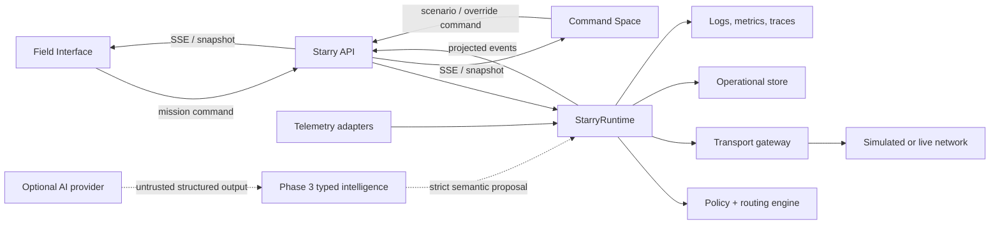
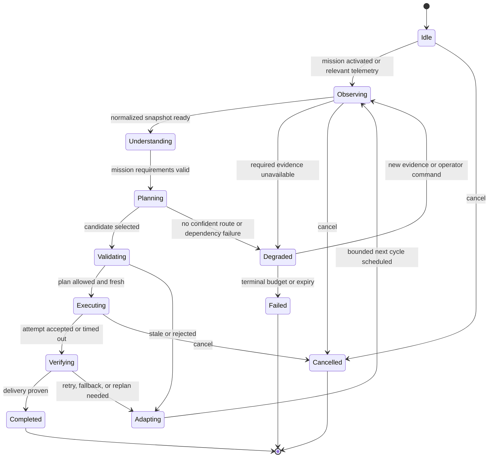

# StarryLink Next Architecture

Status: Phase 0 design baseline with Phase 1 domain, Phase 2 runtime, and bounded Phase 3 communication intelligence

Primary implementation language: TypeScript

Scope: the autonomous routing engine, its API and persistence boundaries, and the two user experiences that consume it

Phase 1 implements the pure domain slice under `src/`: validated state schemas, a directed graph, bounded route discovery, deterministic policy/scoring, an independent final validator, simulated execution, ACK verification, an in-memory event store, scenario fixtures, and a CLI. Phase 2 extends that slice with `src/runtime/`: a typed lifecycle, normalized simulation observations, bounded adaptation, event idempotency, stale-event protection, deterministic metrics, autonomous fixtures, and a runtime CLI. See `docs/domain-engine.md` for the core formulas and `docs/starry-runtime.md` for the runtime contract.

## 1. Purpose

StarryLink Next is a communication control system for unstable environments. It continuously turns network, device, mission, and historical outcome data into a safe transmission plan, executes the plan, verifies delivery, and replans when reality changes.

The central product behavior is:

```text
observe -> understand -> constrain -> score -> optionally advise -> validate
        -> execute -> verify -> learn -> adapt
```

“AI-native” means that the product is built around this autonomous decision loop. It does not mean that a language model is trusted with safety-critical control. The loop, predictive scoring, memory, and adaptation are core. A language-model provider is an optional, bounded adviser for ambiguous mission interpretation and candidate ranking.

## 2. Architectural goals

The first implementation must make these properties demonstrable and testable:

- A scenario changes environment state; the runtime, not the UI, changes the route.
- Every action is derived from an immutable input snapshot and a versioned policy.
- Hard safety constraints cannot be weakened by a scorer, AI provider, simulator, or manual route preference.
- Every transmission has a bounded lifetime, idempotency key, retry budget, verification result, and decision trace.
- Failure of an optional AI provider leaves a working deterministic system.
- Simulated and live modes use the same domain pipeline and differ only at injected I/O boundaries.
- Operational memory contains verified communication outcomes, not chat history.
- The UI receives projected state and commands the runtime through an API; it never owns authoritative domain state.
- A user can pause autonomy, request an allowed route, cancel a mission, or issue an emergency stop.
- No client bundle, event, trace, log, screenshot, fixture, or document contains a provider secret.

Non-goals for the first build are production telecom integration, physical LoRa or satellite control, drone control, account management, a vector database, a general multi-agent framework, and high-fidelity infrastructure modeling.

## 3. System context and trust boundaries



There are four trust zones:

1. **Browser clients are untrusted.** They may request missions, scenarios, and overrides but cannot assert environment truth, mark a message delivered, choose live credentials, or mutate policy.
2. **The server runtime is the authority.** It owns state versions, decision generation, policy validation, execution leases, and verification.
3. **External inputs are untrusted.** Sensor readings, relay advertisements, mission text, ACKs, and AI output require schema validation, freshness checks, provenance, and bounds checks.
4. **External providers and transports are least-privilege integrations.** They receive only the data required for one operation. Provider responses are advice; transport responses are evidence, not automatic proof of end-to-end delivery.

## 4. Proposed repository and package boundaries

The repository should use a TypeScript workspace with one lockfile and shared compiler/lint/test configuration. A concrete target layout is:

```text
starrylink-next/
  apps/
    web/                  # Landing, Command Space, Field Interface
    api/                  # HTTP/SSE boundary and composition root
  packages/
    domain/               # Pure types, value objects, events, invariants
    policy/               # Versioned hard rules and constraint evaluation
    routing/              # Candidate enumeration, estimators, scoring
    runtime/              # StarryRuntime orchestration and state machines
    providers/            # AIProvider contracts and server-only adapters
    transports/           # Transport contracts, simulator, future live adapters
    simulation/           # Seeded scenarios and virtual telemetry sources
    persistence/          # Repositories, migrations, event/outbox storage
    observability/        # Domain telemetry ports and safe exporters
    contracts/            # API schemas and client-safe event projections
    testkit/              # Builders, fakes, virtual clock, replay helpers
  docs/
  tests/
    scenarios/            # Cross-package acceptance and golden-path tests
```

### Dependency direction

Dependencies point inward toward the domain:

```text
apps/api -> runtime -> policy / routing -> domain
apps/web -> contracts -> domain
providers / transports / persistence / observability -> domain ports
simulation / testkit -> public ports from domain and runtime
```

Rules:

- `domain` has no framework, database, browser, Node-specific, provider-SDK, or transport dependency.
- `policy` and `routing` are deterministic, side-effect-free libraries unless an explicit estimator port is injected.
- `runtime` depends on ports, never concrete databases, provider SDKs, or network transports.
- `providers` is server-only. It must never be imported by `apps/web` or a client-safe package.
- `contracts` contains only schema-validated, redacted wire types. Domain entities are not serialized directly.
- `apps/api` is the composition root that chooses simulated/live adapters and supplies policy, clocks, IDs, stores, and limits.
- UI animation state is a projection of runtime events and must not feed back as authoritative system state.

Workspace tooling can be selected during implementation, but package boundaries are architectural; they should not be collapsed merely to reduce initial file count.

## 5. Domain model

All persisted and transmitted domain structures carry a `schemaVersion`. IDs are opaque branded strings. Durations use integer milliseconds; timestamps use UTC ISO-8601 at boundaries and an injected monotonic clock for elapsed-time calculations.

### 5.1 State snapshots

`EnvironmentSnapshot` is a normalized, immutable view of communication conditions at one state version:

- channel state for cellular, Wi-Fi, LoRa, satellite, and supported relay links;
- availability, signal, estimated bandwidth, latency, jitter, packet loss, congestion, energy cost, and monetary cost;
- network graph nodes and directed edges, including relay capability and observation provenance;
- freshness and quality for every observation, rather than one blanket “current” flag;
- optional bounded weather risk or other contextual risk signals.

`DeviceSnapshot` contains battery percentage, optional estimated runtime, supported interfaces, bounded signal readings, coarse location when permission allows it, and device capability flags.

`Mission` separates user intent from derived requirements:

- immutable payload reference and payload metadata; raw content is kept out of traces;
- mission type: medical emergency, distress, safety status, coordination, or general;
- normalized urgency, minimum reliability, maximum tolerable latency, energy tolerance, expiry, privacy class, and delivery semantics;
- lifecycle status and current generation;
- origin, destination, and deduplication identity.

`OperationalMemorySnapshot` contains only bounded, aggregated, verified outcomes such as route success counts, failure counts by reason, latency distribution, last successful fallback, relay freshness, and sample size. It includes a window, decay policy, and data provenance.

### 5.2 Planning types

A route is a sequence of typed hops over a particular graph version. It is not a display string such as `5G -> LoRa`.

```ts
type RouteCandidate = {
  routeId: RouteId;
  graphVersion: number;
  hops: readonly RouteHop[];
  estimates: {
    deliveryProbability: number;
    latencyMs: number;
    energyUnits: number;
    monetaryCostUnits: number;
  };
};
```

`ConstraintResult` records allow/deny, hard or soft severity, a stable reason code, policy version, and evidence references. `CandidateScore` records named components and total score using a versioned scoring profile.

`RoutingDecision` contains:

- input state version, mission generation, policy version, and scoring version;
- selected primary and ordered fallback route IDs from the enumerated candidate set;
- retry, compression, redundancy, timeout, and verification policies;
- confidence and expected outcomes, each with its basis and sample size;
- validation result and expiry time;
- concise reason codes and a human-readable decision summary;
- decision source: deterministic, AI-assisted, deterministic fallback, or manual preference;
- no hidden reasoning, raw prompt, scratchpad, or chain-of-thought.

`ExecutionPlan` is produced only from a validated decision. It contains an idempotency key, attempt budget, current generation, payload digest, and explicitly authorized operations. Decisions are descriptive; execution plans are capabilities with short expiry.

### 5.3 Results and verification

`ExecutionResult` records accepted/rejected/timeout/cancelled status for each attempt, transport receipt metadata, bytes sent, and elapsed time. A transport saying “accepted” is not equivalent to delivery.

`VerificationResult` records one of:

- `delivered`: valid end-to-end ACK or transport-specific proof satisfies mission policy;
- `pending`: evidence may still arrive before the verification deadline;
- `retryable_failure`: another attempt on this route is allowed;
- `replan_required`: route assumptions or availability failed;
- `indeterminate`: evidence is insufficient or contradictory;
- `terminal_failure`: mission expiry, attempt budget, or policy prevents further action.

Verification includes evidence type, signer or source where applicable, receipt correlation, observed latency, duplicate status, and stable failure reason codes.

## 6. The authoritative decision pipeline

Every cycle uses the same ordered pipeline:

| Stage | Responsibility | Can cause an external action? |
| --- | --- | --- |
| Normalize | Validate, timestamp, bound, and merge observations | No |
| Understand | Derive mission requirements and situation risk | No |
| Safety precheck | Apply non-negotiable policy and mission validity checks | No |
| Enumerate | Find feasible graph paths and compression/redundancy options | No |
| Constrain | Remove candidates that violate hard policy | No |
| Score | Rank allowed candidates using deterministic weighted estimates and memory | No |
| AI advise (optional) | Classify ambiguity or reorder an allowlisted candidate set within bounded influence | No |
| Validate | Re-run policy, schemas, state freshness, budgets, and route existence | No |
| Execute | Acquire a generation lease and call one transport capability | Yes |
| Verify | Correlate ACK/evidence against the mission and attempt | No new action |
| Learn | Update memory only from verified outcomes | No |
| Adapt | Decide completion, retry, fallback, replan, degraded mode, or manual escalation | Schedules a new bounded cycle |

The ordering is a security and reliability property. In particular:

- AI advice never sees or resurrects candidates removed by hard constraints.
- A final validator reruns all action-relevant policy after optional AI advice.
- The runtime compares the decision input version with current state immediately before execution. Materially stale decisions are discarded and replanned.
- The executor accepts only a short-lived validated plan, not arbitrary provider or browser output.
- Memory updates cannot retroactively change the result of an in-flight cycle.

## 7. StarryRuntime lifecycle

`StarryRuntime` is an event-driven supervisor, not an uncontrolled `while (true)` loop. The API starts one runtime, and the runtime manages a bounded worker per active mission. The first demo may enforce one active mission, but the identifiers and isolation model should support several later.



### 7.1 Scheduling and single-flight behavior

- Cycles start because of a mission command, a material observation change, a retry/verification timer, an operator command, or a bounded heartbeat.
- At most one planning/execution cycle per mission generation is allowed at a time.
- Bursty observations are coalesced during a short debounce window, while hard failures and emergency escalation bypass debounce.
- A new material state version aborts planning and optional provider work for the older version.
- An accepted external send is not assumed cancelable. Its result is still verified, but no stale completion may trigger a second action in a newer generation.
- Route-switch hysteresis and minimum improvement thresholds prevent flapping. Hard route failure, policy violation, or mission escalation bypasses hysteresis.
- Each cycle has a transition budget. Exceeding it enters degraded mode and schedules an operator-visible bounded retry rather than spinning.

### 7.2 Cancellation hierarchy

Cancellation is propagated through linked `AbortSignal`s:

```text
application shutdown
  -> mission cancellation / emergency stop
    -> cycle invalidation
      -> provider, transport attempt, verification wait, backoff timer
```

Every port accepts an abort signal. Adapters must settle promptly on cancellation and must distinguish cancellation from timeout and transport failure. Persisted terminal state is written once; late results become audit events and cannot revive a cancelled mission.

### 7.3 Timeouts and retry budgets

Limits are policy/configuration, not scattered constants. The baseline requires:

- one overall mission deadline derived from mission expiry;
- a maximum cycle duration;
- shorter observation, provider, transport-attempt, and verification deadlines;
- per-route attempt caps and a mission-wide attempt cap;
- exponential backoff with bounded jitter for transient retry, using an injected clock and randomness source;
- no retry for invalid input, hard policy rejection, explicit cancellation, payload expiry, or non-retryable transport errors;
- fallback or full replan when the failure invalidates route assumptions;
- rate limits per mission, device, destination, transport, and operator command.

Retries use the same message deduplication identity and a new attempt identity. A retry can never silently reset the mission-wide budget. Critical missions may receive larger budgets through policy, but no mission has an infinite budget.

### 7.4 Safe execution concurrency

The runtime acquires a compare-and-set execution lease over `(missionId, generation, decisionId)` before acting. This prevents two workers or process restarts from sending conflicting plans. Redundant parallel transmission is allowed only when the selected policy explicitly authorizes it for a reliability-critical mission; all copies share a recipient-visible deduplication key.

## 8. Policy, constraints, scoring, and validation

### 8.1 Deterministic policy

Policy is versioned, code-reviewed/config-reviewed, and immutable during a decision cycle. Example hard rules include:

- valid mission, destination, payload size, privacy class, and expiry;
- route interfaces and hops are supported and recently observed;
- battery floor and reserved-energy behavior;
- maximum attempts, latency, message expansion, and cost ceiling;
- emergency priority and allowed redundancy;
- prohibited relays, regions, transports, or payload classes;
- offline fallback and stale-telemetry behavior;
- operator permissions and emergency-stop precedence.

Policy returns stable reason codes and evidence. It does not return prose alone.

### 8.2 Constraint engine

The constraint engine evaluates each candidate independently and is pure for a given input snapshot. A denied hard constraint removes a candidate. Soft constraints become score penalties but remain visible in the trace. If all candidates are denied, the system enters a named no-feasible-route/degraded state; it never asks an AI provider to invent a route.

### 8.3 Deterministic scoring

The initial scorer is transparent and versioned. It combines normalized expected delivery, latency, energy, monetary cost, congestion, relay trust, and historical evidence. Mission requirements select weights; for example, medical emergencies strongly weight reliability and deadline fit, while a low-battery noncritical message strongly weights energy and deferral.

All score components, normalizers, missing-data penalties, and tie-break rules are recorded. Ties use a stable route ID order, making replay deterministic. Expected delivery probability is kept separate from “decision confidence”; the former estimates an outcome, while the latter represents evidence sufficiency and choice stability.

### 8.4 Final policy validator

Validation is an independent module, not a boolean returned by the planner that created the decision. It checks:

- schema and numeric bounds;
- candidate membership and graph version;
- policy/scoring version and route allow status;
- state freshness and material-version consistency;
- mission generation, expiry, rate limit, cost, energy, and attempt budgets;
- provider influence caps and structured-output provenance;
- executable adapter capability;
- manual preference authorization, if present.

Validation produces a signed-in-process capability object with a short expiry. The executor accepts only that object. Validation is repeated if relevant state changes before the transport call.

## 9. Optional AI provider boundary

The provider abstraction is narrow and server-side:

```ts
interface AIProvider {
  classifyMission(input: MissionClassificationInput, signal: AbortSignal): Promise<StructuredMissionAdvice>;
  adviseRoutes(input: RouteAdviceInput, signal: AbortSignal): Promise<StructuredRouteAdvice>;
  summarizeDecision(input: DecisionFacts, signal: AbortSignal): Promise<StructuredSummary>;
}
```

The domain runtime also supports a `NoAIProvider` and a deterministic simulated provider. Provider implementations may differ, but contracts and validation do not.

Provider rules:

- Inputs are minimized and redacted. Prefer mission categories and derived requirements over raw message content or precise location.
- Route advice contains only allowlisted candidate IDs, bounded adjustments/reasons, and declared uncertainty. It cannot name a transport operation or supply executable arguments.
- Outputs use strict structured schemas, reject unknown fields, validate numeric bounds and candidate membership, and have explicit schema versions.
- Parse failure, timeout, provider refusal, rate limiting, or low confidence emits a provider-fallback event and resumes deterministic planning.
- The planner never retries provider calls indefinitely and never lets provider latency consume the mission execution deadline.
- Free-form provider text is not executed. Decision summaries are preferably rendered from validated reason codes; if provider-assisted wording is used, it is treated as display text and checked for length and sensitive content.
- Prompts never request or expose chain-of-thought. Raw hidden reasoning, scratchpads, prompts, and provider secrets are neither shown nor written into decision traces.
- Credentials exist only in the server environment or a deployment secret store. The browser receives neither credentials nor a provider SDK capable of direct authenticated calls.

An AI provider may break close scores among already-allowed routes only within a configured influence bound. It cannot override hard constraints, the final validator, manual emergency stop, or an explicit route prohibition.

## 10. Simulated and live modes

Mode is selected at the server composition root and is explicit in every run, event, metric, and UI projection.

| Boundary | Simulated mode | Live mode |
| --- | --- | --- |
| Observation source | Seeded scenario/virtual telemetry | Authenticated device and network adapters |
| Transport gateway | Deterministic simulated sends and ACKs | Feature-gated transport integrations |
| AI provider | None, deterministic fake, or opted-in provider | Optional configured provider |
| Clock | Virtual or controlled clock | Monotonic system clock |
| Runtime/policy/routing | Production modules | The same production modules |
| Persistence/events | Real repositories under a simulation run ID | Real repositories under a live run ID |

Scenario definitions change input state and scheduled outcomes only. They must not specify the expected route as an instruction to the runtime or directly mutate UI decision state. Seed, scenario version, policy version, and event log make a run replayable.

Live mode is disabled by default until a concrete transport has authentication, authorization, privacy, adapter contract, safety review, and end-to-end verification. A deployment must never silently fall back from live to simulated execution or mix simulated ACKs into a live mission.

## 11. Persistence and operational memory

Use SQLite for local development and the offline demo, with Postgres as the deployable server option. Repositories hide the database choice. A vector database is unnecessary for the initial operational statistics and must not be added without a concrete semantic-retrieval requirement.

Persist these logical records:

- missions and their current generation/status;
- normalized environment/device snapshots or compact deltas with provenance;
- append-only runtime/domain events;
- decision records, candidate score components, policy results, and summaries;
- execution attempts, receipts, and verification evidence metadata;
- bounded route/channel/relay performance aggregates;
- scenario runs, seeds, versions, and expected assertion sets;
- manual override, pause, cancel, and emergency-stop audit records;
- transactional outbox entries for projected client events.

Raw payloads, precise location, and provider request/response content are not general telemetry. Store a digest, size, class, and protected reference when the payload is required for delivery. Retention and location precision are policy-controlled.

### 11.1 Consistency and recovery

- State changes and their outbox event are committed atomically.
- Snapshots are projections; the event log is the audit source. Snapshot schema versions support migrations.
- Runtime startup reloads active missions, increments or recovers generation safely, and reacquires leases before work.
- An execution result is idempotently upserted by attempt ID.
- Memory aggregates update only from accepted verification events and are rebuildable from the log.
- A database outage enters degraded persistence state. If a local durable spool remains available, critical deterministic communication may continue under policy and is reconciled later. If no audit path is durable, the runtime exposes the condition and follows a configured fail-safe; it never pretends full autonomous health.

## 12. Event model and API projections

Domain events are immutable, versioned facts. Every event envelope includes:

- `eventId`, `eventType`, and `schemaVersion`;
- UTC occurrence time and monotonic sequence within a mission;
- `runId`, `missionId`, `missionGeneration`, `cycleId`, and correlation/causation IDs as applicable;
- state, graph, policy, scoring, and scenario versions;
- simulated/live mode and source provenance;
- a redacted typed payload.

Core event families include the following canonical facts. More granular internal
events may exist, but scenario tests and client projections use this vocabulary so
the engine, evidence plan, and interface do not drift apart:

```text
mission.requested / mission.updated / mission.classified / mission.activated
mission.deferred / mission.delivered / mission.failed / mission.cancelled
observation.received / observation.normalized / observation.rejected / observation.stale
situation.assessed / situation.changed / route.degraded / recovery.detected
planning.started / route.candidates_scored / decision.proposed
provider.requested / provider.advice_accepted / provider.fallback_used
policy.approved / policy.rejected / decision.invalidated
route.updated
execution.started / execution.attempt_accepted / execution.attempt_failed / execution.attempt_timed_out
verification.started / verification.ack_received / verification.failed / verification.indeterminate
adaptation.retry_scheduled / adaptation.fallback_selected / adaptation.requested
runtime.degraded / runtime.paused / runtime.resumed / runtime.emergency_stopped
memory.updated / persistence.degraded
```

The API exposes:

- command endpoints for mission submission, scenario activation, autonomy pause/resume, allowed manual preference, cancel, and emergency stop;
- read endpoints for current projected state, topology, mission, and decision details;
- an SSE stream for ordered, reconnectable client-safe events using the last event ID;
- readiness/health endpoints that distinguish runtime, persistence, provider, and transport status.

Commands use command IDs and idempotency keys. The server validates authorization and returns acceptance/rejection; clients do not assume a button press changed domain state. WebSocket can replace SSE later if bidirectional streaming is required, but it is not needed for the initial server-to-client timeline.

## 13. Observability

Observability must prove the loop operated without leaking mission content or secrets.

### 13.1 Structured logs and traces

Logs use event and reason codes plus correlation IDs. Traces create spans for each cycle stage and external adapter call. Attributes include mode, route ID, state/policy/scoring versions, bounded durations, outcome class, attempt number, and cancellation reason. Do not log raw payloads, exact location, auth material, provider prompts, provider raw output, or transport credentials.

### 13.2 Metrics

Required metrics are:

- delivery success rate by scenario, mission class, and route family;
- route recovery time and failover success;
- decision and end-to-end latency distributions;
- attempts/retries per mission;
- estimated energy and monetary cost;
- confidence distribution and degraded/manual escalation count;
- stale observation and provider-fallback counts;
- policy violations blocked before execution;
- **executed policy violations**, which must remain zero.

The UI label “Policy violations: 0” must use the executed-violation metric and not hide blocked proposals. Blocked proposals are useful evidence that the safety layer worked.

### 13.3 Health

Health is multidimensional, not one green dot:

- observation freshness;
- policy and runtime availability;
- persistence/audit durability;
- provider status (optional and non-authoritative);
- transport readiness;
- active mission degraded state.

## 14. Security and privacy

The first threat model must cover forged telemetry, replayed or forged ACKs, duplicate commands, malicious relay advertisements, prompt injection in user content, provider data leakage, memory poisoning, unauthorized manual overrides, stale-decision execution, and denial-of-service through event storms.

Required controls:

- schema validation and strict numeric/range limits at every boundary;
- authenticated, nonce/timestamp-protected telemetry and verification evidence when live adapters exist;
- command authentication, authorization, rate limits, CSRF protection where applicable, and an immutable override audit trail;
- fixed allowlists for provider endpoints and route capabilities;
- encryption in transit and protected storage for payload references and sensitive location;
- least-privilege adapters and separate simulation/live capabilities;
- input data minimization, location precision reduction, explicit retention, and deletion policy;
- redaction at the logging boundary plus automated secret/PII leakage tests;
- content treated as data, never as instructions to policy or tools;
- memory updated only from verified, provenance-bearing events with bounded influence and decay;
- dependency pinning, vulnerability scanning, and server/client bundle analysis.

Manual override means a human can choose among policy-allowed preferences or stop the system. It does not mean the browser can bypass privacy, energy reserve, prohibited-route, or execution-budget hard constraints. Any exceptional policy break-glass mechanism belongs to a later, separately authenticated and audited design.

## 15. Test seams and verification strategy

All nondeterminism and side effects enter through injected ports:

| Seam | Test replacement |
| --- | --- |
| Wall/monotonic clock and timers | Virtual clock and scheduler |
| ID generation | Deterministic ID sequence |
| Random jitter / simulation | Seeded random source |
| Observation source | Scripted telemetry stream |
| AI provider | no-op, valid, malformed, slow, refusing, or adversarial fake |
| Transport gateway | scripted acceptance, loss, delay, duplicate, and ACK behavior |
| Verification source | signed/invalid/stale/duplicate ACK fixtures |
| Repositories/outbox | in-memory contract fake plus SQLite/Postgres integration tests |
| Policy/scoring configuration | versioned test policies and profiles |
| Event/telemetry sink | collecting sink with redaction assertions |

Test layers:

- pure unit tests for normalization, policy, route enumeration, scoring, confidence, reason rendering, and memory updates;
- property tests for invariants such as “a denied route never executes,” bounded retries, and idempotent duplicate events;
- state-machine tests for every legal/illegal transition and cancellation race;
- provider contract tests for strict structured output, unknown fields, timeouts, and candidate injection;
- repository contract tests against both supported databases;
- scenario acceptance tests driven only by inputs, including cellular degradation, infrastructure collapse, low battery, medical emergency, and route failure;
- deterministic replay tests comparing decisions and traces from a recorded event stream;
- API/client projection tests, browser tests, accessibility tests, and mobile viewport tests;
- fault-injection tests for provider, persistence, transport, and observation outages.

The golden-path acceptance test should assert the event sequence and invariant outcomes, not exact wall-clock animation timing. It must show environment degradation, observation, candidate evaluation, a validated `5G -> LoRa` change, execution, ACK verification, and timeline projection without any direct UI route mutation.

## 16. Key architecture decisions

1. **One runtime, four logical roles.** Observer, Mission, Routing, and Verification are typed modules coordinated by `StarryRuntime`, not independent conversational agents.
2. **Deterministic authority, optional probabilistic advice.** Hard policy and final validation always control executable behavior.
3. **Event-driven and bounded.** Work starts from explicit triggers, carries cancellation, and is limited by deadlines, rates, attempts, transitions, and generations.
4. **Event log plus projections.** The decision timeline is an audit projection of real runtime events, not a scripted animation.
5. **Adapters define modes.** Simulation and live execution share the same runtime and differ only at explicit I/O ports.
6. **Operational, verifiable memory.** Only bounded communication outcomes affect future decisions; no chat transcript or premature vector store.
7. **Explain facts, not hidden reasoning.** Reason codes, score components, constraints, confidence basis, and outcomes are visible; chain-of-thought is neither requested nor exposed.
8. **Server-side provider and execution boundary.** The browser cannot access provider credentials or issue transport operations directly.

These decisions form the acceptance boundary for Phase 1 and Phase 2 implementation. Changes that weaken them should require an architecture decision record and corresponding invariant tests.
