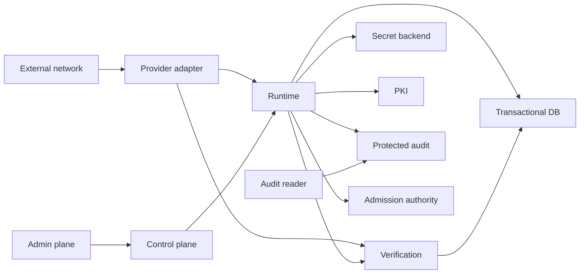

# Phase 4G — Staging Infrastructure Threat Model & Adapter Selection

Status: implemented locally as architecture, disconnected contracts, typed configuration, and deterministic simulation; intentionally uncommitted; no external infrastructure activated

## 1. Executive decision

| Foundation | Preferred staging adapter architecture | Explicit fallback | Phase 4G activation |
|---|---|---|---|
| Secret custody | Vault-class KV metadata plus Transit-class non-exportable operations | OS keychain for an explicitly selected single-host developer profile only | `CONTRACT_ONLY`, unavailable |
| PKI/service identity | SPIFFE/SPIRE-class workload identity under a staging-only private CA | Vault-PKI-class CA as an explicit alternative trust domain | `CONTRACT_ONLY`, unavailable |
| Transaction persistence | PostgreSQL-class serializable relational store | None | `CONTRACT_ONLY`, unavailable |
| Protected audit | Immutable object storage with retention plus independent signed checkpoints | Identity-preserving read-only replica only | `CONTRACT_ONLY`, unavailable |
| Distributed admission | PostgreSQL-class serializable quota coordination with a separate schema/role | Redis-class atomic adapter only after separate acceptance evidence | `CONTRACT_ONLY`, unavailable |

These are adapter-class decisions, not claims that a product, endpoint, credential, certificate, database, object bucket, or quota service exists. Every selected adapter reports `UNAVAILABLE`. Requested hardened backends never fall back to memory or local files.

> Infrastructure may store, authenticate, authorize, rate-limit, audit, reconcile, and provide evidence, but infrastructure alone never establishes authoritative delivery.

## 2. Assets and security objectives

| Asset | Required property | Authority status |
|---|---|---|
| Mission and authoritative delivery state | Integrity, monotonic generation, reconstruction | Authoritative only inside sealed runtime/verifier path |
| Verification and callback evidence | Authentication, correlation, replay resistance | Evidence until explicit verification |
| Secret handles and key material | Non-exportability, purpose binding, rotation/revocation | Never delivery authority |
| Service identities, private keys, trust roots/bundles | Isolation, bounded lifetime, authenticated generation | Authentication only |
| Authorization policy and configuration | Non-rollback, same-generation immutability | Permission only |
| Transactions, idempotency, leases, reconciliation | Atomicity, durability, explicit ambiguity | Persistence only |
| Audit chain, manifests, checkpoints | Append orientation, tamper evidence, historical verification | Observational only |
| Global/service/mission/route/provider rate state | Atomic update, deterministic order, restart recovery | Admission only |
| Control-plane state | Role separation, generation binding, traceability | Operational permission only |

Objectives are to preserve sealed delivery authority; keep private material in custody; bind operations to workload identity, purpose, and generation; classify transaction ambiguity; detect audit tampering; atomically apply all quota scopes; and separate infrastructure administration from mission authority.

## 3. Threat actors and trust boundaries

Actors include: unauthenticated external actor; compromised provider; runtime process; operator; security administrator; audit reader; staging host; database credential; secret-backend credential; certificate/private key; malicious insider; stale service instance; replaying service; network adversary; and dependency/supply-chain adversary.

No infrastructure administrator is assumed benign. A database, Vault, PKI, audit-storage, or quota administrator may damage its component, but none receives delivery authority.



Plain-text view: `external ↔ provider ↔ runtime ↔ verification`; `admin ↔ control ↔ runtime`; and `runtime ↔ secret backend | PKI | DB | audit | quota`. Each crossing requires explicit authentication, authorization, generation, bounded input, stable failure classification, idempotency where mutation is possible, and audit/observability evidence.

## 4. Material threat analysis

`Delivery?` asks whether the threat itself can establish delivery. `NO` can still mean severe confidentiality, integrity, or availability harm.

| Threat | Asset | Boundary | Prerequisite and attack path | Control | Residual risk | Detection | Recovery | Delivery? |
|---|---|---|---|---|---|---|---|---|
| Credential theft | Backend credentials | runtime→backend | Read host/process credential, then reuse it | Short-lived workload identity, no config secrets, least privilege | Use during remaining lifetime | Identity/audit anomaly | Revoke, rotate, rebuild workload | NO |
| Secret exfiltration | Signing keys | runtime→custody | Export/log key after custody or host compromise | Non-exportable API, opaque purpose-bound handles | Custody/admin compromise | Custody audit and scans | Revoke version, rotate, investigate | NO |
| Privilege escalation | Policy | admin→control/backend | Lower role grants itself broader operation | Separate domains, signed generation, closed operations | Security-admin compromise | Policy diff | Freeze and supersede generation | NO |
| Confused deputy | Secret/provider operation | runtime→adapter | Valid identity asks service to act for wrong mission/route | Service, purpose, operation, route, generation binding | Policy defect | Denial/correlation audit | Correct newer policy | NO |
| SSRF | Adapter endpoint | runtime→network | Poison endpoint toward metadata/public host | Endpoint-class enum, no raw URL, later egress policy | Host bypass | Egress/DNS evidence | Isolate host; rotate | NO |
| Replay | Mutations | service→backend | Resubmit captured valid request | Idempotency key, fingerprint, sequence/generation | Replay before durable record | Duplicate/conflict audit | Return stored result or reconcile | NO |
| Downgrade | Capability/trust mode | config→adapter | Select weaker backend or TLS mode | Closed enums/capabilities, no implicit fallback | Malicious newer config | Config checkpoint/diff | Supersede generation | NO |
| Stale generation | All policy | stale service→backend | Old instance operates on old policy | Exact generation; stale rejection | Rollout availability | Stale-generation evidence | Refresh or stop instance | NO |
| Rollback/same-generation overwrite | Configuration | admin→registry | Reapply lower gen or change same-gen bytes | Monotonic generation, canonical fingerprint | Generation-store compromise | Rejection audit | Restore protected registry | NO |
| Split brain | DB/quota | network→coordination | Two writers accept one generation | Single authority, serializable isolation, fencing | Backend/failover defect | Divergence/constraint alert | Fail closed and reconcile | NO |
| Transaction ambiguity | Transaction state | client→DB | Response lost during commit | Durable transaction identity/ledger | Ledger loss | Ambiguous-result evidence | `UNKNOWN_REQUIRES_RECONCILIATION` | NO |
| Partial/duplicate commit | State/idempotency | DB/client | Partial visibility or blind replay | One transaction, constraints, immutable fingerprint | DB or semantic defect | Invariant scan | Quarantine; restore/replay | NO |
| Stale lease | Work ownership | worker→DB | Paused worker resumes after takeover | CAS fencing generation and owner identity | Lease policy defect | Fencing rejection | Reconcile and reissue | NO |
| Audit deletion/truncation | Ledger | storage admin→objects | Delete versions or present valid prefix | Retention, terminal count/hash checkpoint | Root storage control | Count/hash/checkpoint mismatch | Restore protected copy | NO |
| Audit rewriting | Ledger | writer/storage | Rewrite objects and hashes | Immutable versions, independent signature | Signer also compromised | Signature/version evidence | Quarantine export | NO |
| Checkpoint forgery | Checkpoint | signer→reader | Sign false terminal hash/count | Dedicated purpose, signer generation, retained verification | Signer compromise | Cross-reader/version comparison | Revoke signer; recovery checkpoint | NO |
| Quota bypass | Admission | runtime→quota | Skip/deceive admission adapter | Architecture gate, atomic decision identity, fail closed | Compromised runtime | Missing admission evidence | Stop workload; reconcile | NO |
| Rate divergence/admission race | Quota | workers/network→quota | Concurrent separate-scope debits or partition | One serializable all-scope transaction, stable lock order | Coordination defect/contention | Snapshot/gen divergence | Freeze and rebuild | NO |
| Certificate substitution | Identity | network→service | Present trusted but wrong cert | SPIFFE URI SAN, trust domain, purpose, bundle generation | Issuer mis-issuance | Handshake identity audit | Revoke/rotate trust | NO |
| Trust-root compromise | Trust | PKI→workloads | Issue arbitrary workload identities | Offline root, constrained intermediate, short SVIDs | Broad impersonation | Unexpected issuance | Freeze/replace hierarchy | NO |
| Callback/provider spoofing | Evidence | external/provider→runtime | Forge provider acceptance or ACK-like callback | mTLS, signature, strict schema, correlation/replay, explicit verifier | Provider+evidence compromise | Auth/correlation audit | Revoke, quarantine evidence | NO; verifier still required |
| Dependency compromise | Process | supply chain→runtime | Malicious package alters classification/exfiltrates | Minimal locked deps, audit, architecture tests | Build-system compromise | Hash/SBOM anomaly | Pin/remove/rebuild | NO |
| Configuration poisoning | Adapter selection | config→registry | Inject secret, endpoint, fallback, weak mode | Strict schema, forbidden keys, placeholder endpoints | Authorized malicious newer config | Canonical config evidence | Freeze/supersede | NO |
| Operator/admin misuse | Control/infrastructure | human→service | Disable, delete, rotate, or exhaust | Bounded separate roles, generations, audit | Denial/confidentiality loss | Cross-domain audit | Revoke and recover | NO |
| Crash recovery ambiguity | External mutation | process→backend | Crash after mutation before local knowledge | Durable operation ID/reconciliation state | Backend evidence loss | Pending reconciliation | Resume; never infer delivery | NO |
| Compromised runtime | Mission flow | runtime→all | Omit controls or forge calls/evidence | Least privilege, verifier separation, backend constraints | Severe evidence/availability harm | Cross-service traces | Stop/rebuild; leave unverified | NO unless verifier also compromised |
| Compromised verifier | Delivery state | evidence→verification | Emit false verified outcome | Narrow sealed path, independent review, event tests | Authority compromise | Impossible-event audit | Halt delivery authority | YES |

Highest-risk paths are verifier compromise, trust-root plus policy compromise, custody compromise, and ambiguous external commit. Only verifier compromise reaches delivery directly.

## 5. Adapter decision matrix

| Criterion | Secret | PKI | Transaction | Audit | Admission |
|---|---|---|---|---|---|
| Identity | Workload→policy | SPIFFE workload ID | Per-service DB role | Writer/signer/reader | Dedicated quota role |
| Generation | Secret+config | Bundle+SVID | Row/schema/config | Object/checkpoint | Policy/decision |
| Outage | Fail closed | Fail new auth closed | Classify commit boundary | Checkpoint pending | Fail admission closed |
| Retry | Same identity if allowed | Reauthenticate | Same tx ID; reconcile first | Same record/checkpoint ID | Same request ID; reconcile first |
| Phase 4G network | None | None | None | None | None |

## 6. ADR-A — Secret custody

Decision: Vault-class KV metadata plus Transit-class non-exportable operations for isolated multi-service staging. Workload identity maps to least-privilege policy; configuration stores opaque references only.

| Choice | Strength | Limit | Verdict |
|---|---|---|---|
| OS keychain | Local OS integration, no network, low cost | Single host; limited multi-service identity/audit | Developer-only explicit fallback |
| Vault class | Versioning, policy, revocation, audit, workload auth | Availability/recovery complexity | Preferred staging class |
| Cloud KMS/secret manager | Managed availability, production migration | Account, billing, provider/network dependency | Deferred alternative |
| HSM custody | Strong non-exportability/separation | Cost/hardware complexity | Deferred production path |

Versions are monotonic and service/purpose/operation bound. Historical signing is prohibited; bounded public verification remains. Revocation fails current operations, and an uncertain in-flight mutation reconciles. Losing the selected backend identity fails closed. `OS_KEYCHAIN_LOCAL` is accepted only under `EXPLICIT_LOCAL_DEVELOPER_ONLY`; it is never a Vault outage fallback and does not imply `secret.destroy`.

## 7. ADR-B — PKI/service identity

Decision: SPIFFE/SPIRE-class workload identity under a staging-only private CA.

```text
spiffe://staging.arci.internal/runtime/<instance>
spiffe://staging.arci.internal/provider/<adapter>
spiffe://staging.arci.internal/verification/<instance>
spiffe://staging.arci.internal/control/<instance>
spiffe://staging.arci.internal/admin/<role>
spiffe://staging.arci.internal/audit-reader/<reader>
```

- Exact URI SAN is mandatory; DNS SAN never substitutes for workload identity.
- Server/client purposes stay separate.
- Conceptual hierarchy: offline staging root → constrained staging intermediate → workload SVID. No key/certificate is generated.
- Target leaf lifetime is 30 minutes; renew before half-life. Target intermediate/root lifetimes are 30 days/one year. These are future acceptance inputs, not issued artifacts.
- Bundles are signed/versioned with monotonic `trustGeneration`. Publish new trust before new SVIDs; allow one bounded overlap generation.
- Retain audit verification material separately from live mTLS trust.
- Short-lived SVID plus authenticated deny-list generation handles revocation.
- Pin trust domain, expected SPIFFE ID, issuer generation, and operation policy; avoid routine leaf pinning.
- Allow at most 60 seconds handshake skew. Correctness tests inject time; scheduler time never controls authority.
- Wrong SAN/service/purpose/issuer/generation, expiry, or substitution fails authentication. Authentication still does not authorize.

Vault-PKI-class CA is an explicit alternative trust domain, never automatic failover.

## 8. ADR-C — Transactional persistence

Decision: PostgreSQL-class relational storage because the contract needs multi-entity atomicity, uniqueness, CAS, serializable isolation, durable transaction identity, and inspectable recovery in one authority.

| Conceptual entity | Key rule | Purpose |
|---|---|---|
| `infrastructure_transactions` | Unique ID; immutable fingerprint | Idempotency/reconciliation |
| `mission_state` | Mission ID + version CAS | Projection, not delivery setter |
| `transmission_attempts` | Attempt and mission/generation unique | Claim/fencing |
| `outbound_requests` | Request/idempotency unique | Persist-before-provider |
| `provider_evidence` | Callback/envelope/evidence unique | Replay resistance |
| `correlation_records` | Correlation unique | Evidence association |
| `reconciliation_records` | Operation unique + version | Durable ambiguity recovery |
| `runtime_ingestion_markers` | Evidence/runtime gen unique | Duplicate prevention |
| `audit_outbox` | Audit ID/sequence unique | Atomic audit handoff |
| `schema_generations` | Component monotonic | Migration control |

Claim/fence, state invariants, and audit-outbox writes share transactions where required. Network provider calls never occur inside a DB transaction. Isolation is `SERIALIZABLE` or a proven lock/constraint equivalent. Serialization abort is `NOT_COMMITTED`; loss during commit is `UNKNOWN_REQUIRES_RECONCILIATION`.

Migrations are forward-only, numbered/checksummed, single-authority, and generation-recorded. Apps declare supported schema bounds; stale instances fail before mutation. Runtime, verifier, reconciler, migrator, read-only audit, and DB admin use distinct roles. No fallback database is permitted.

## 9. ADR-D — Audit storage/checkpoints

Decision: immutable versioned object batches with retention, plus independently protected checkpoint envelopes. An append-only DB alone leaves data and manifest under one administrator.

```text
transaction + audit_outbox
→ canonical hash-linked records
→ immutable batch object
→ terminal checkpoint payload
→ dedicated checkpoint signer
→ protected checkpoint object
→ independent reader
```

Checkpoint `4G.CHECKPOINT.1` contains stable checkpoint ID, terminal SHA-256 hash, exact record count, generation, logical time, dedicated signer identity reference, `AUDIT_CHECKPOINT_SIGNING` purpose, and versioned verification-material reference.

`NonCryptographicCheckpointTestAuthority` is marked `TEST_ONLY_NON_CRYPTOGRAPHIC_SHA256`, contains no key, provides no security, and tests lifecycle/canonicalization only. Retired signers may verify historical checkpoints but cannot sign. Public verification material remains available across rotation; historical signing does not.

Append success with checkpoint failure is `UNKNOWN_REQUIRES_RECONCILIATION` for completeness and cannot establish/undo delivery. Readers reject deletion, reorder, rewrite, truncation, wrong count, wrong signature, and wrong generation. Only an explicit same-evidence/same-generation read-only replica may fail over.

## 10. ADR-E — Distributed admission

Decision: PostgreSQL-class serializable coordination in a separate schema/role. One transaction:

1. checks request ID and canonical fingerprint;
2. verifies exact quota generation;
3. locks global, service, mission, route, provider buckets in stable lexical order;
4. refills from injected logical ticks, never DB wall time;
5. rejects without any debit if one scope lacks capacity;
6. atomically debits all scopes and persists decision/snapshot generation;
7. returns identical stored duplicates and rejects conflicting reuse.

Outage fails admission closed. Lost results reconcile by request ID. A partial partition never activates local acceptance.

Redis-class coordination is a future explicit fallback only if it proves all-scope atomicity, durable idempotency, generation fencing, restart equivalence, failover non-rollback, pinned script/function version, and reconciliation. It is not connected or inferred from `admission.atomic`.

## 11. Adapter contracts and capabilities

Every adapter exposes class/type, backend/evidence identity, generation, health, declared capabilities, operation/idempotency identity, retry/timeout classification, stable failure, audit/observability identity, and `authoritativeDelivery: false`.

Phase 4G only implements `DisconnectedStagingAdapter`. It validates generation/capabilities, then returns `INFRASTRUCTURE_BACKEND_UNAVAILABLE`, `NEVER`, and `NOT_STARTED`. It imports no socket, TLS, provider, runtime, verifier, or control-plane implementation.

Closed capabilities:

```text
secret.versioned  secret.rotate  secret.revoke  secret.destroy
pki.mtls          pki.rotate     pki.revoke
transaction.cas   transaction.serializable     transaction.idempotent
audit.append      audit.checkpoint             audit.verify
admission.atomic  admission.distributed        admission.snapshot
```

Unknown → `CAPABILITY_UNKNOWN`; known but unsupported → `CAPABILITY_UNSUPPORTED`. Nothing is inferred from backend names.

## 12. Configuration integrity

Strict schema `4G.1` contains adapter type/name, placeholder endpoint class, identity reference, `CONTRACT_ONLY` activation, capabilities, logical timeout, retry, consistency, durability, explicit fallback, trust/config generations, checkpoint signer reference, and feature flags.

It rejects unknown fields/adapters/capabilities; capability/class mismatches; bad identity/class references; duplicate classes; credential-bearing keys at any nesting; raw endpoints; weak durability/consistency; retries without reconciliation for ambiguity; implicit/cross-class fallback; stale trust; rollback; same-generation conflict; and non-security-admin global configuration.

## 13. Failure and recovery matrix

| Failure | Classification | Retry/recovery |
|---|---|---|
| Secret backend unreachable/stale | `NOT_COMMITTED` | Restore same identity/load authenticated generation |
| Secret revoked mid-operation | `UNKNOWN_REQUIRES_RECONCILIATION` | Verify evidence, then rotate |
| Cert expires mid-operation | `UNKNOWN_REQUIRES_RECONCILIATION` | Reauthenticate and reconcile |
| Trust rotates | `NOT_COMMITTED` if rejected | Refresh authenticated bundle |
| Identity mismatch | `NOT_COMMITTED` | Never retry; isolate peer |
| DB unavailable/before commit | `NOT_COMMITTED` | Same transaction ID after known abort |
| DB during commit/response lost/recovery ambiguous | `UNKNOWN_REQUIRES_RECONCILIATION` | Query transaction ledger first |
| Audit sink/checkpoint unavailable | `NOT_COMMITTED` | Same evidence identity/ID |
| Append succeeds/checkpoint fails | `UNKNOWN_REQUIRES_RECONCILIATION` | Verify append, then checkpoint |
| Admission unavailable | `NOT_COMMITTED` | Never admit locally |
| Duplicate admission | `COMMITTED` | Return stored identical result |
| Admission result lost | `UNKNOWN_REQUIRES_RECONCILIATION` | Read decision by request ID |
| Stale quota | `NOT_COMMITTED` | Load authenticated policy |
| Partial partition | `UNKNOWN_REQUIRES_RECONCILIATION` | Fail closed and reconcile |
| Crash after external commit | `UNKNOWN_REQUIRES_RECONCILIATION` | Same idempotency key |
| Restart during reconciliation | `UNKNOWN_REQUIRES_RECONCILIATION` | Resume durable cursor |

Ambiguity never establishes delivery. Health never repairs authoritative mission state.

## 14. Failover policy

Read-only audit may fail over only when explicit, authenticated, same generation, and same evidence identity. Secret custody, PKI trust domain, transaction authority, audit writer/checkpoint authority, and quota authority never silently fail over. Future failover needs explicit authority identity, fencing generation, deterministic selection, non-rollback proof, and reconciliation tests; DNS/client-library failover alone is insufficient.

## 15. Administrative separation and observability

```text
runtime ≠ provider ≠ operator ≠ security administrator ≠ audit reader
        ≠ DB admin ≠ Vault admin ≠ PKI admin ≠ audit-storage admin ≠ quota admin
```

Thus DB admin ≠ runtime authorization; Vault admin ≠ delivery authorization; PKI admin ≠ mission authorization; audit-storage admin ≠ delivery; quota admin ≠ delivery. Infrastructure grants authorize named operations at an exact generation and always return false authority. Revoked/stale grants fail closed.

Health evidence records backend identity, generation, `UNAVAILABLE|DEGRADED|AVAILABLE`, and injected tick. It is `OBSERVATIONAL`. It cannot repair mission state, bypass verification, mutate delivery, or grant operator authority.

## 16. Authority proof

```text
secretValid             → authoritativeDelivery FALSE
tlsAuthenticated        → authoritativeDelivery FALSE
transactionCommitted    → authoritativeDelivery FALSE
auditVerified           → authoritativeDelivery FALSE
rateLimitAdmitted       → authoritativeDelivery FALSE
operatorAuthorized      → authoritativeDelivery FALSE
providerAccepted        → authoritativeDelivery FALSE
callbackAuthenticated   → authoritativeDelivery FALSE
callbackCorrelated      → authoritativeDelivery FALSE
```

Exactly one Phase 4G scenario delegates to the sealed composition:

```text
verification.started
→ verification.ack_received
→ mission.delivered
→ runtime.completed
```

Architecture tests reject infrastructure imports of privileged completion modules, delivery setters, true authority, sockets, environment credentials, TLS bypass, and in-memory fallback.

## 17. Determinism and historical 20 ms timeout

Phase 4G uses injected logical budgets/classifications and introduces no clock read, random ID, socket, timer, race, or unordered canonical result.

The historical discrepancy is isolated to sealed Phase 4E's loopback `provider-timeout` harness. It configures Node socket inactivity to 20 ms while the local server withholds a response. CPU/event-loop contention may delay timer callback wall time or an outer runner observation, but cannot create acceptance/callback evidence: the gateway normalizes timeout to `PROVIDER_TIMEOUT`/`TIMED_OUT`, retries use the same request identity, every result is non-authoritative, and the verifier is never invoked.

Independent stress ran 40 sequential and 40 concurrent timeout scenarios: all 80 returned `PROVIDER_TIMEOUT`. The uncontended 54×10 Phase 4E gate and full suite had zero divergence. Conclusion: test-harness wall-clock scheduling noise, not semantic or authority nondeterminism. No timeout was widened. Future contract tests inject classification; socket tests should not canonize precise elapsed wall time.

## 18. Scenario results

The 101 official scenarios cover disconnected selection/health, capability compatibility, configuration poisoning/rollback/conflict, all 21 required failures, checkpoint tampering/rotation, allowed/forbidden failover, role separation, and authority implications. Determinism executes 101 × 10 = 1,010 canonical results and requires zero isolated divergences.

## 19. Known limitations

- No real client, handshake, isolation level, object retention, or distributed failover is tested.
- The checkpoint signer is deliberately non-cryptographic.
- PostgreSQL, Redis, and SPIFFE/SPIRE behavior is specified, not exercised.
- Backup/restore, performance, capacity, cost, regional recovery, and compliance are unmeasured.
- Configuration registry durability awaits Phase 4H.
- Phase 4E socket timeout elapsed wall time is not deterministic evidence.

## 20. Explicitly deferred work

Real staging provisioning; credentials/accounts; Vault/KMS/HSM/keychain connection; CA/SVID/certificate issuance; staging/production DB connection; Redis/distributed quota connection; production-signed checkpoints; immutable cloud storage/log shipping; backup/restore; DNS/public ingress/firewalls; provider contact/API calls/billing; compliance certification; and hardware/HSM/telecom/satellite/LoRa integration.

## 21. Phase 4H recommendation

After Phase 4G review, proceed only to **isolated disposable adapter contract acceptance**: instantiate credential-free local infrastructure and implement one adapter at a time behind these contracts. Keep public ingress, provider contact, production credentials/accounts, and production deployment forbidden. Do not begin Phase 4H until Phase 4G is deliberately sealed.
