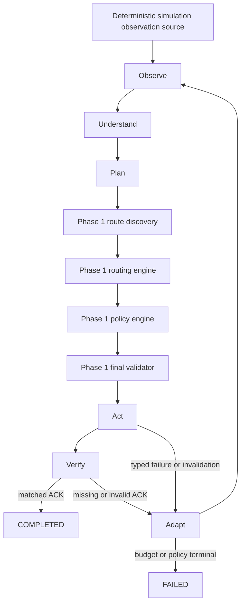

# Autonomous StarryRuntime

Status: Phase 2 implemented

Scope: deterministic simulation only

## Runtime loop

`StarryRuntime` connects the Phase 1 decision and execution core into one closed loop:



The runtime orchestrates; it never selects a route itself. Candidates come from bounded graph discovery. The routing engine scores them, policy evaluates them, and only a final-validator `ExecutionCapability` can reach the simulated executor.

## Lifecycle state machine

The lifecycle states are `IDLE`, `OBSERVING`, `UNDERSTANDING`, `PLANNING`, `EXECUTING`, `VERIFYING`, `ADAPTING`, `COMPLETED`, and `FAILED`.

The canonical success path is:

```text
IDLE → OBSERVING → UNDERSTANDING → PLANNING
     → EXECUTING → VERIFYING → COMPLETED
```

Execution or verification recovery follows:

```text
EXECUTING / VERIFYING → ADAPTING → OBSERVING → ...
```

`src/runtime/state-machine.ts` owns the transition table. Invalid transitions throw `InvalidRuntimeTransitionError`. Each accepted transition emits `runtime.state_updated`, so lifecycle history is representable in the append-only event journal.

## Observation and understanding

Every Phase 2 observation declares `source: SIMULATION`. Supported inputs represent snapshots, environment and interface changes, graph-edge availability, device battery/interface changes, mission requirement changes, ACK arrivals, and timeouts.

Raw observations do not mutate planner or executor state. `normalizeRuntimeObservation` first validates the schema, rejects duplicate/stale inputs and stale graph versions, then produces normalized environment, device, mission, and graph state. Environment and topology changes create a new graph version. Fixture time and observation order are explicit and deterministic.

## Autonomy bounds and termination

Default limits are:

| Bound | Default |
| --- | ---: |
| `maxIterations` | 8 |
| `maxReplans` | 3 |
| `maxExecutionAttempts` | 6 |
| `maxAttemptsPerRoute` | 2 |

Every fixture also supplies an absolute deterministic mission deadline. The loop is a finite `for` bounded by `maxIterations`; replans, retries, per-route attempts, global execution attempts, and deadline checks are enforced independently. Terminal outcomes are always `COMPLETED` or `FAILED`. Typed failure reasons include `NO_VALID_ROUTE`, `AUTONOMY_BUDGET_EXHAUSTED`, `EXECUTION_ATTEMPTS_EXHAUSTED`, and `MISSION_DEADLINE_EXCEEDED`.

## Adaptation engine

Adaptation is a typed decision, not a blind rerun:

| Trigger | Deterministic action |
| --- | --- |
| `EXECUTION_FAILED` | `REPLAN` |
| `ACK_TIMEOUT` | `RETRY_ROUTE`, then `REPLAN` after the per-route bound |
| `ROUTE_INVALIDATED` | `REPLAN` |
| `NETWORK_TOPOLOGY_CHANGED` | `REPLAN` |
| `GRAPH_STALE` | `REFRESH_OBSERVATION` |
| `RELIABILITY_DEGRADED` | `REVALIDATE_ROUTE` |
| `BATTERY_CRITICAL` | `REPLAN` |
| `MISSION_REQUIREMENTS_CHANGED` | `REPLAN` |
| `POLICY_REJECTION` | `ABORT_MISSION` |

Every `AdaptationRecord` stores its trigger, action, reason, previous decision/route, causal event, iteration, and budget impact. Medical emergencies still pass all hard safety policies; urgency changes scoring priorities but grants no validator bypass.

## Event causality

Events remain in the Phase 1 in-memory append-only store. IDs come from a deterministic sequential source. Every event carries mission identity, run correlation, sequence, and—after the first event—the immediately preceding event as causation.

Canonical success evidence is:

```text
mission.requested
→ runtime.state_updated (OBSERVING)
→ observation.received
→ runtime.state_updated (UNDERSTANDING)
→ observation.normalized
→ planning.started
→ route.candidates_scored
→ policy.approved
→ route.updated
→ execution.started
→ execution.attempt_accepted
→ verification.started
→ verification.ack_received
→ mission.delivered
→ runtime.completed
```

Failure recovery adds `execution.attempt_failed`, `route.invalidated` when applicable, `adaptation.started`, and `adaptation.decided` before the next observation/planning cycle.

## Idempotency and late-event protection

The runtime records processed external observation/ACK IDs and execution IDs.

- A duplicate ACK or observation is journaled as ignored and cannot create another transition or mission completion.
- A duplicate execution result cannot increment attempts or cause a second adaptation/replan.
- ACK verification still correlates `messageId`, `executionId`, and `routeId` through the Phase 1 verifier.
- A late ACK from execution A is tested against current execution B, recorded as stale, and cannot verify B or complete the mission.
- `mission.delivered` is guarded to occur at most once and only after `VERIFIED`.

## Deterministic metrics and replay

Metrics include iterations, replans, retries, execution attempts, route history, adaptation count, ACK/verified ACK counts, policy rejections, invalidations, ignored duplicates/late events, and terminal state/reason. There is no synthetic confidence metric.

`npm run runtime -- determinism` replays six critical cases ten times. It compares route and decision IDs, execution IDs/outcomes, triggers/actions, counts, terminal and verification state, the full event sequence and causal/correlation chain, and all metrics.

## Runtime safety invariants

Executable tests enforce:

- only final-validator-approved routes execute;
- approved executions contain zero hard-policy violations;
- no retry, replan, per-route attempt, global attempt, iteration, or deadline bound is exceeded;
- completion implies a correlated verified ACK;
- delivery is emitted at most once;
- duplicate and late inputs have no unsafe effect;
- every adaptation has a causal event;
- every autonomous scenario terminates.

## Known limitations

- Network, telemetry, clocks, ACKs, and transport outcomes are simulated.
- There is no live hardware, modem, LoRa, satellite, drone, GPS, or mobile-radio integration.
- There is no LLM, model SDK, prompt routing, embedding, or agent framework.
- Events and runtime state use in-memory persistence only.
- There is no production observability, concurrency host, distributed idempotency store, or recovery after process restart.
- There is no production API or UI.
